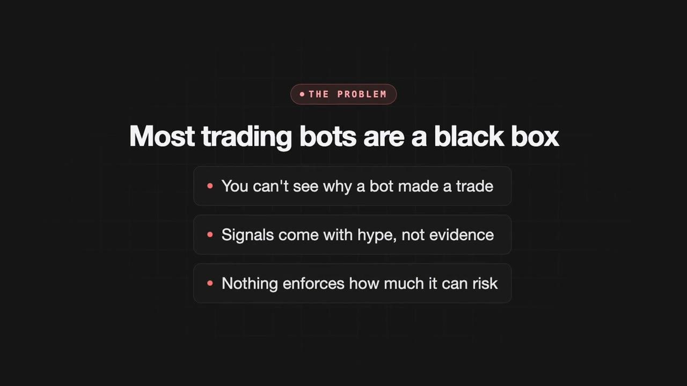

<p align="center">
  
</p>

# Orca

**AI trading agents that show their work, and act on Solana only inside limits you set.**

Orca finds an opportunity, explains *why* with cited evidence, and, if you allow it, trades on-chain. Every action leaves a record you can replay: the data it saw, the reasoning, the risk checks, and the result.

---

## Watch the intro (2 min, with voice)

[](docs/video/orca-intro.mp4)

**[▶ Watch](docs/video/orca-intro.mp4)** · **[⬇ Download the video (MP4, 12 MB)](https://github.com/ayushsingh82/lev-trade/raw/main/docs/video/orca-intro.mp4)**

What is live today: market sentiment, the Intelligence Board, markets, RSI research, news impact and order flow, plus three bots watching live data. Coming in the beta: sign-in with a wallet, paper-trading agents, and live agents inside your limits.

---

## The problem

- **Research tools stop at insight.** You get charts and headlines, then switch to another app to act, after the move has decayed.
- **Trading bots act without evidence.** You can't see why they traded, and a bad model output can drain a wallet.

## The idea: two products, one loop

Orca combines two ideas that are each half a product:

| | Idea 1: AI crypto trading platform | Idea 2: autonomous AI trading agents | Orca |
| --- | --- | --- | --- |
| What it gives | Discover opportunities, analyze markets, execute | Agents that analyze, manage a portfolio and trade | Both, in one pipeline |
| What's missing | A safe way to act on the insight | Evidence you can audit before and after a trade | Every trade is backed by cited evidence and boxed in by hard limits |

Idea 1 is the **brain** (market intelligence). Idea 2 is the **hands** (agents that execute). Orca puts a strict, non-AI layer between them:

```
 Intelligence ──► Agents ──► Risk Engine ──► Execution
 discover +       decide      deterministic    Jupiter swap on Solana,
 analyze          (propose)   code, no LLM     limited-authority signer
 (cited, live)                                 + human approval if needed
```

**The rule that makes it safe: the AI proposes; plain code disposes.** No model output reaches a wallet without passing the Risk Engine.

## What you can do

| You want to... | Orca gives you |
| --- | --- |
| Browse and search tokens | **Markets**: the top 50 and the main Solana ecosystem tokens (price, 1h/24h/7d change, market cap, volume, 7-day chart), search across every listed coin, sort and filter, and follow the ones you care about |
| Research a token's momentum | **RSI Research**: 14-period RSI on 1h, 4h, 24h and 7d for the tracked tokens and for any token you open, with zones, price changes, 1-year range position and a 7-day 1h RSI chart |
| See what's worth attention right now | **Opportunities**: assets ranked by conviction, with direction, reasons, cited headlines and flagged contradictions |
| Understand a move | **Signal detail** and **Ask Orca**: cited answers grounded in live data, with the evidence that disagrees shown, not hidden |
| Get started in one click | **Starter agents**: Momentum Scout, News Rotator and RSI Dip Watcher. Each is a paper agent in observe mode that runs on live data straight away and reports what it would do |
| Automate a strategy | **Agents** from templates (Momentum, Narrative Rotation, RSI Reversion), each with its own limits and **its own choice of tokens** from a reviewed list of 14 tradable Solana tokens (large caps by default, memecoins opt-in and marked high risk) |
| Trust before you risk money | **Paper trading**: a virtual $1,000 filled at real Jupiter quotes, with live PnL |
| Stay in control | Three modes per agent: **observe** (log only), **propose** (you approve each trade), **autonomous** (acts within limits) |
| Fund it | **Wallet**: every new user gets their own Solana wallet at sign-up (through Privy), shows balances, can be funded by card or crypto, and can fund an agent in one step |
| Take it back out | **Withdraw** from any live agent to your own wallet: USDC, SOL or everything. Funds can only go to your wallet |
| Know what happened | **Decision log** (full record per run), **Portfolio** (total value, realized and unrealized PnL, win rate, allocation, equity curves, CSV export) and **Telegram alerts** |

### How an agent decides

1. A scheduler (or **Run now**) wakes the agent.
2. It reads live signals plus its own book and policy.
3. Its strategy produces a **proposal** (buy or sell, which asset, how much) or does nothing.
4. The **Risk Engine** checks it against the policy: allowed assets, per-trade and daily caps, slippage, minimum conviction, concentration, kill switches, and cross-source contradictions.
5. Result: **reject**, **log only**, **queue for your approval**, or **execute**. A high-severity contradiction automatically downgrades an autonomous agent to asking you first.
6. A **Decision Record** is saved either way, and you get an alert.

## Why it's different

1. **Evidence-gated.** No trade without a cited record of why.
2. **Limits that are enforced, not promised.** The Risk Engine is deterministic and unit-tested (including malformed and hostile model output). Each agent's signer only holds what you fund it with.
3. **Contradictions matter.** When news, sector breadth, flow and macro disagree, Orca says so and acts more cautiously.
4. **Real data only.** No mock data and no templated theses. If a source is down you see an error or the last real response, never a fabricated number.
5. **Auditable.** Every trade can be replayed from data to decision to transaction.

## Who it's for

- Retail traders who stitch five tabs together to understand one move.
- Small funds and DAO treasuries that want policy-bound automation.
- Builders who want to fork an agent template.

## Plans

| | Free | Pro (~$29/mo) | Teams (~$199/mo) |
| --- | --- | --- | --- |
| Ask Orca | 5 / day | 100 / day | Unlimited (fair use) |
| Agents | 3, paper and observe only | 5, live execution | 25 |
| Modes | observe | observe, propose, autonomous | all |
| Alerts | No | Telegram | Telegram |

Limits are enforced server-side. Paid plans are sold through Stripe or Dodo Payments subscriptions, or by USDC; prices are placeholders to validate. Orca will not take a cut of trades or a performance fee.

## Where the code comes from

The intelligence layer is ported from MarketMind, a read-only research app that never trades. Orca keeps its SoSoValue and SoDEX clients, news-impact and contradiction engine, and grounded-LLM pattern (in `app/src/lib/intel/`), then adds what MarketMind deliberately lacked: accounts, agents, a risk engine, paper trading and execution. Details in [`app/plan.md`](app/plan.md).

## Architecture

```
SoSoValue ─┐                                       ┌─ Decision Records (Postgres)
SoDEX ─────┼─► Signal engine ─► Agent runtime ─────┤
Jupiter ───┘   (OrcaSignal)     (strategies)       └─► Risk Engine ─► Paper ledger
                                                                   └► Jupiter swap ─► Solana
```

| Layer | Where |
| --- | --- |
| Data and signals | `app/src/lib/intel/`, `app/src/lib/signals.ts` |
| Risk Engine and policy | `app/src/lib/risk/`, `app/src/lib/agents/policy.ts` |
| Strategies and runner | `app/src/lib/agents/` |
| Execution (Jupiter, signer, paper) | `app/src/lib/exec/` |
| Accounts and plan limits | `app/src/lib/auth/`, `app/src/lib/entitlements.ts` |
| Schema | `app/src/db/schema.ts` and `app/drizzle/` |

**Stack:** Next.js 16, React 19, Tailwind v4 (BestUI dark theme), Drizzle + Neon Postgres, Solana (`@solana/web3.js`, wallet standard), Jupiter swap API, `jose` sessions.

## Safety model

- **Non-custodial by design.** Your own wallet is never given to Orca. Each live agent has its own signer, encrypted at rest, that holds only the amount you send it. Exposure = what you fund + the Risk Engine limits.
- **Real sending is off by default.** Nothing goes on-chain unless `EXECUTION_ENABLED=1`. Otherwise swaps are quoted and simulated against real mainnet state.
- **Price guard.** Before any paper fill or swap, the Jupiter quote must be within the trade's slippage plus 150bps of an independent reference price (SoSoValue). Worse quotes are refused.
- **Approvals are re-checked.** Approving a queued trade re-runs the Risk Engine on fresh balances before anything swaps.
- **Kill switches.** Per agent, and platform-wide with `ORCA_GLOBAL_KILL=1`.
- **On-chain funding cap (optional).** A live agent can be linked to a Squads vault you control with one daily limit it can use. The Squads program, not Orca's server, then bounds how much the agent can ever pull; Orca re-verifies the vault on chain before every top-up. Squads limits cover transfers, not swaps, so this caps funding, not individual trades. Verified end to end on a local validator running the real Squads program; not yet run on mainnet. See [`docs/ONCHAIN_LIMITS.md`](docs/ONCHAIN_LIMITS.md).
- **Known limit:** without a vault, the server holds each agent signer's key and exposure is what you fund it with plus the Risk Engine limits.
- **Signal scoring is backtested, not proven.** `app/scripts/backtest.ts` showed 1-day momentum (the original driver) had a negative average, so direction now follows 7- and 14-day trend plus news. With ~450 daily observations nothing is statistically significant, and conviction is a ranking, not a probability.

> Not financial advice. Trading is risky and you can lose money. Start with paper trading and small amounts.

## Status

| Milestone | State |
| --- | --- |
| M0 Scaffold and BestUI theme | Done |
| M1 Intelligence: opportunities, signal detail, Ask Orca (Anthropic or OpenAI-compatible) | Built; Ask Orca needs an LLM key |
| M0.5 Accounts: Solana wallet and email sign-in, Neon, daily limits | Built; needs a database to run |
| M2 Agents: strategies, runner, Decision log, paper trading and PnL | Built; needs a database to run |
| M3 Risk Engine | Done, tested |
| M4 Solana execution: Jupiter, agent signer, approvals | Built; live sending off by default |
| M5 Scheduling, portfolio page, Telegram alerts | Built; scheduler needs `CRON_SECRET` |
| M6 Hardening: price guard against an independent reference, 429 retry, priority fee option, mainnet pilot cap | Built: price guard (live-tested), Jito bundle sending (tx build verified against Jupiter and Jito; sending untested). CoinGecko is the second price source instead of Pyth |
| M7 Billing: Stripe checkout, portal, webhook, billing page | Built; Stripe needs keys and prices; USDC payments verified on-chain (logic tested, never run live) |
| M8 Growth: referral links, shareable Decision Records (the public leaderboard is switched off for the MVP) | Built; referral rewards (30 days of Pro per paying referral, max 12) need the database to run |

## What you need

Orca works in layers. Each layer needs a few more things, and you can stop at any one.

| To get | You need | Variables |
| --- | --- | --- |
| **Live board, signals, news, sectors, index and ETF flows** (no login) | A SoSoValue API key | `SOSO_API_KEY` |
| **Sign-up with a wallet created for the user** (email or Google, embedded Solana wallet) | A free Privy app | `NEXT_PUBLIC_PRIVY_APP_ID`, `PRIVY_APP_SECRET` (optional: without them the app falls back to email and wallet sign-in) |
| **Ask Orca** | An Anthropic key, or any OpenAI-compatible endpoint | `ANTHROPIC_API_KEY`, or `OPENAI_BASE_URL` + `OPENAI_MODEL` + `OPENAI_API_KEY` |
| **Accounts, agents, paper trading, portfolio, decision log** | A Postgres database (Neon) and two random secrets | `DATABASE_URL`, `AUTH_SECRET`, `AGENT_KEY_SECRET` |
| **Scheduled agent runs** | A secret the scheduler sends | `CRON_SECRET` |
| **Telegram alerts** | A bot from @BotFather | `TELEGRAM_BOT_TOKEN` |
| **Card subscriptions** | Stripe, Dodo Payments, or both | Stripe: `STRIPE_SECRET_KEY`, `STRIPE_WEBHOOK_SECRET`, `STRIPE_PRICE_PRO`, `STRIPE_PRICE_TEAMS`. Dodo: `DODO_PAYMENTS_API_KEY`, `DODO_PAYMENTS_WEBHOOK_KEY`, `DODO_PAYMENTS_ENV`, `DODO_PRODUCT_PRO`, `DODO_PRODUCT_TEAMS` |
| **USDC subscriptions** | A Solana wallet address you control | `TREASURY_WALLET` |
| **Real on-chain trades** | A funded agent signer and an explicit opt-in | `EXECUTION_ENABLED=1` (leave unset until you are ready), optional `PILOT_MAX_TRADE_USD`, `JITO_TIP_LAMPORTS` |

Jupiter, SoDEX and CoinGecko are read without a key. RSI Research uses CoinGecko's free tier, which is rate limited: the first cold load fetches about 10 price histories one at a time and can take 30 seconds or more. An optional free `COINGECKO_API_KEY` (a Demo key) makes it faster.

Generate the secrets with `openssl rand -hex 32` (once each for `AUTH_SECRET`, `AGENT_KEY_SECRET` and `CRON_SECRET`). Keep a copy of `AGENT_KEY_SECRET`: if it is lost, every stored agent signer becomes unreadable.

### Deploying to Vercel

1. Import the repo and set the **Root Directory** to `app`.
2. Add the variables above. Mark keys, tokens and `DATABASE_URL` as **Secret**; prices, product ids, the treasury address and similar can be **Config**.
3. Add the Neon integration (it sets `DATABASE_URL`), then run `npx drizzle-kit migrate` once against it. Nothing creates the tables automatically.
4. The cron in `app/vercel.json` runs once a day, because Vercel Hobby allows nothing more frequent. For hourly runs use Vercel Pro, or call `/api/cron/run-agents` from an external scheduler with `Authorization: Bearer <CRON_SECRET>`.
5. SoSoValue's demo plan allows 10 requests a minute, so the first load of a cold instance can take up to a minute. Data pages allow up to 60 seconds and show a loading skeleton meanwhile.
6. **Privy (optional):** in the Privy dashboard enable Email and Google, set the embedded wallet chain to Solana, and add your Vercel URL (and `http://localhost:3000`) to the allowed origins. Set `NEXT_PUBLIC_PRIVY_APP_ID` (a public id) and `PRIVY_APP_SECRET` (secret) in Vercel, then redeploy because the public id is baked in at build time.
7. Stripe and Dodo webhooks point at `/api/billing/webhook` and `/api/billing/dodo/webhook`.

### Not finished

- **Run for real, locally:** accounts, wallet sign-in, agents, paper trading, approvals, plan limits, referral rewards, the Stripe and Dodo webhooks (with correctly signed test events), USDC payments, and the Squads cap. See "Verification scripts".
- **Not run yet:** a real Stripe or Dodo checkout, a real LLM answer (needs a key), a real mainnet swap, and the Squads and funding screens clicked through with a real browser wallet. The Squads and USDC checks used a local chain, not mainnet.
- **Privy** sign-in, the Wallet page and "fund an agent from my Orca wallet" are written and type-checked, and the account-linking logic is tested on a real database, but they have never run against a real Privy app (that needs your app id). Try a sign-up with a small amount first.
- The public leaderboard is switched off for the MVP. Its code is kept, commented out, in `app/leaderboard/page.tsx` and `app/api/agents/[id]/list/route.ts`.
- The legal pages (`/terms`, `/privacy`, `/risk`) are plain templates. Have a lawyer review them before you charge customers or enable live trading.

## Run it

```bash
cd app
cp .env.example .env.local     # then fill in the values below
npm install
npx drizzle-kit migrate        # creates the tables in your Neon database
npm run dev                    # http://localhost:3000
npm test                       # Risk Engine, strategies, paper ledger, billing, RSI, Squads, rate limit
npm run test:db                # database integration tests (needs a LOCAL DATABASE_URL; refuses remote)
```

| Variable | Needed for |
| --- | --- |
| `SOSO_API_KEY` | Live market, news and sector data |
| `DATABASE_URL` | Neon Postgres connection string |
| `AUTH_SECRET`, `AGENT_KEY_SECRET` | Sessions and agent-signer encryption (32+ chars each) |
| `ANTHROPIC_API_KEY` or `OPENAI_BASE_URL` + `OPENAI_MODEL` + `OPENAI_API_KEY` | Ask Orca |
| `CRON_SECRET` | Daily agent runs (`vercel.json`); Vercel Hobby allows daily crons only, so use Pro or an external scheduler for hourly |
| `TELEGRAM_BOT_TOKEN` | Alerts (optional) |
| `STRIPE_SECRET_KEY`, `STRIPE_WEBHOOK_SECRET`, `STRIPE_PRICE_PRO`, `STRIPE_PRICE_TEAMS` | Billing |
| `PILOT_MAX_TRADE_USD` | Optional hard USD cap per trade on every live agent |
| `DODO_PAYMENTS_API_KEY`, `DODO_PAYMENTS_WEBHOOK_KEY`, `DODO_PAYMENTS_ENV`, `DODO_PRODUCT_PRO`, `DODO_PRODUCT_TEAMS` | Billing through Dodo (optional, shows a second button) |
| `TREASURY_WALLET` | Receives USDC subscription payments |
| `SOLANA_RPC_URL`, `NEXT_PUBLIC_SOLANA_RPC` | A dedicated Solana RPC for the server and the browser (the public one is rate limited) |
| `JITO_TIP_LAMPORTS` | Optional: send swaps as tipped Jito bundles |
| `EXECUTION_ENABLED=1` | Real on-chain sending (leave off until you are ready) |

## Verification scripts

Beyond unit tests, three scripts exercise the real thing against local infrastructure (see each file's header):

| Script | What it proves |
| --- | --- |
| `app/scripts/squads-e2e.ts` | The Squads daily cap against the real Squads program on a local validator (17 checks) |
| `app/scripts/usdc-e2e.ts` (+ `usdc-e2e-prep.ts`) | USDC subscription payments with real SPL transfers and the real USDC mint cloned locally (10 checks) |
| `app/scripts/withdraw-e2e.ts` (+ `withdraw-e2e-prep.ts`) | Withdrawals from an agent wallet on a local chain with the real USDC and wBTC mints cloned (14 checks) |
| `app/scripts/withdraw-app-e2e.ts` | The withdraw API and Portfolio page through the running app, on a real Postgres and a local chain (22 checks) |
| `npm run test:db` | Plan limits (race-safe), refunds and referral rewards on a real Postgres |

Local databases use a plain Postgres over TCP (any `DATABASE_URL` pointing at localhost); production uses Neon.

## Docs

| File | What it covers |
| --- | --- |
| [`FLOW.md`](FLOW.md) | The user flow from sign-up to an agent trading inside limits, with the status of each step |
| [`IDEA.md`](IDEA.md) | Product concept, layers, differentiators, non-goals |
| [`PLAN.md`](PLAN.md) | Architecture, tech choices, milestones, tiers and billing, safety rules |
| [`docs/ONCHAIN_LIMITS.md`](docs/ONCHAIN_LIMITS.md) | The Squads funding cap: design, what was verified, what was not |
| [`docs/PAYMENTS.md`](docs/PAYMENTS.md) | Stripe vs Dodo vs USDC |
| [`app/plan.md`](app/plan.md) | How we execute, MarketMind mapping, live status |
